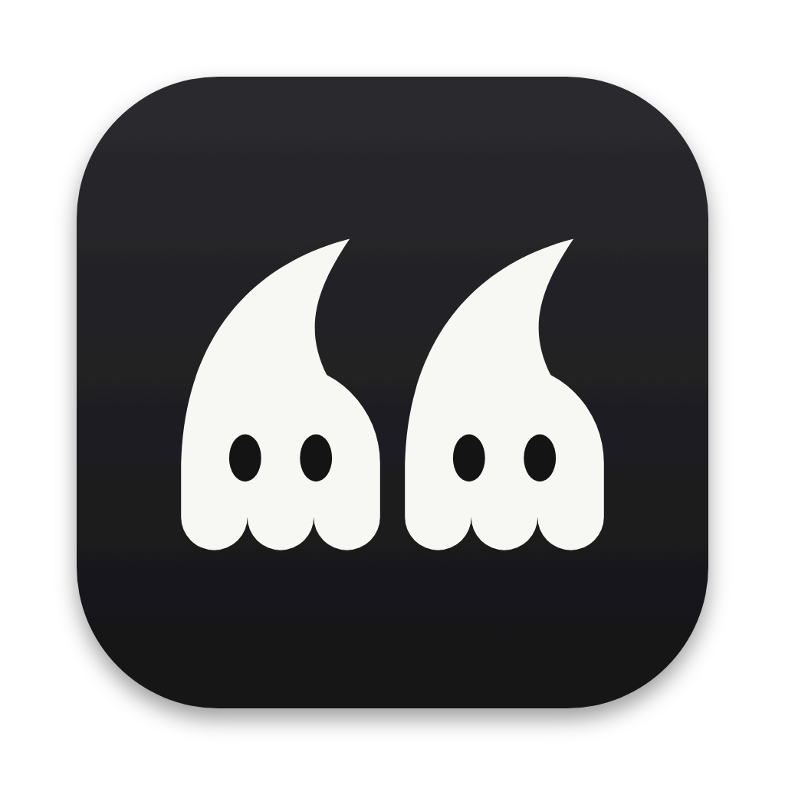
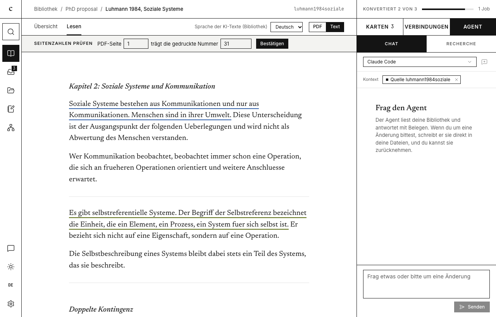
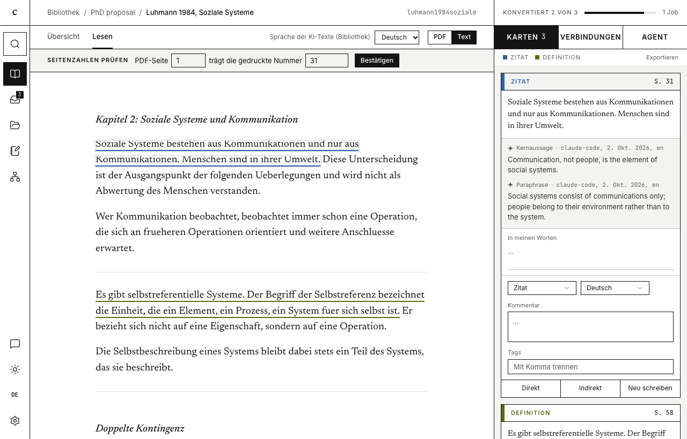
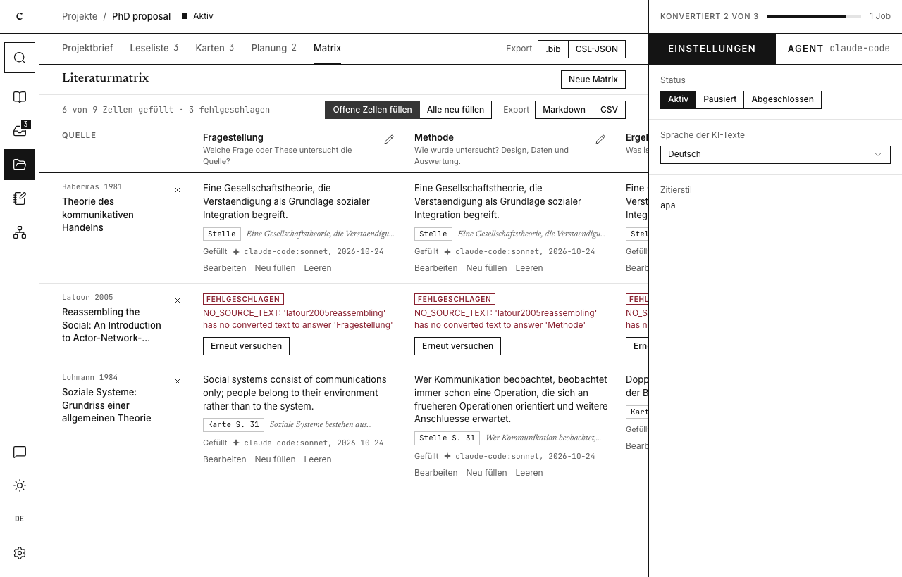
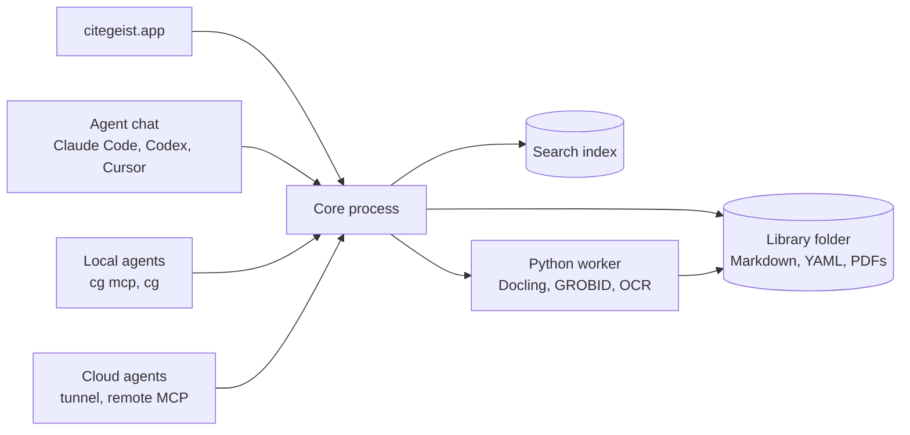

<p align="center">
  
</p>

<h1 align="center">citegeist</h1>

<h3 align="center">The ghost in your library cites its sources.</h3>

<p align="center">
  citegeist is a macOS research library that keeps papers and quote cards as Markdown files,<br>
  and the AI agents you already use search them and cite them down to the printed page.
</p>

<p align="center">
  <a href="LICENSE"></a>
  
  <a href="https://github.com/JonnyFi/citegeist/releases"></a>
</p>

<p align="center">
  <a href="docs/getting-started.md"><b>Getting started</b></a> ·
  <a href="docs/README.md"><b>Documentation</b></a> ·
  <a href="docs/agents.md"><b>Connect an agent</b></a> ·
  <a href="CHANGELOG.md"><b>Changelog</b></a>
</p>

```sh
curl -fsSL https://raw.githubusercontent.com/JonnyFi/citegeist/main/install.sh | sh
```

The script installs `citegeist.app`, links the `cg` command to `~/.local/bin/cg` and updates an existing installation. citegeist needs macOS on Apple Silicon and [uv](https://docs.astral.sh/uv/) (`brew install uv`) for the PDF conversion. The chat runs on the Claude Code, Codex or Cursor command line tool you are logged in to, and the AI tasks can also use an API key or a local Ollama. [Getting started](docs/getting-started.md) walks through the first run.

<!-- Screenshot slot "hero": a paper in the reader with the agent chat open. Replace with the English capture. -->
<p align="center">
  
</p>

## Reading and quote cards

Select a passage in the PDF or text view and choose "Quote". citegeist saves a quote card with the exact wording and the printed page number, and an AI paraphrase appears a few seconds later. When the page numbers of a PDF are uncertain, citegeist asks you once, and every card of that PDF follows your answer.

One click copies a card as a verbatim or an indirect citation. Quick insert opens a card search with a global hotkey and pastes the citation into the app you are writing in.

<!-- Screenshot slot "cards": the reader with the card column. Replace with the English capture. -->
<p align="center">
  
</p>

## Library and import

Paste a DOI, arXiv link, ISBN or URL, or drop a PDF into the window. citegeist looks up the metadata at Crossref, OpenAlex, arXiv, DNB and K10plus, fetches an open-access PDF when one exists and converts it into text blocks with page references. Scans go through local OCR. Imports from Zotero, BibTeX, RIS and CSL-JSON bring an existing collection along, and the Zotero Connector saves straight from the browser. Saved literature searches run as alerts and put new papers into the inbox.

## The agent chat

The "Agent" tab in the right column runs Claude Code, Codex or Cursor on your own subscription. The agent answers from your cards and cites them. When you ask for a change, it writes into your notes and texts directly, and "Undo" takes back the whole turn.

## Agents outside the app

**Works with** Claude Code · Codex · Cursor · Claude Desktop · Grok Bot · any MCP client

`cg mcp` starts an MCP server with tools for search, reading by page, cards, notes, links, projects and citations. The `cg` command line exposes every operation of the app with `--json` output, which suits bulk work. Cloud agents such as Grok Bot reach the library through a tunnel and a remote MCP endpoint.

```sh
claude mcp add --scope user citegeist -- cg mcp      # register citegeist in Claude Code

cg items add 10.48550/arXiv.1706.03762               # add a paper by DOI
cg search query "attention heads" --kinds card --json
```

By default, anything an agent adds lands in the inbox, marked with its origin. [Connecting agents](docs/agents.md) has the setup for each client, and the [security model](docs/security-model.md) describes what agents may do.

## Notes, links and projects

Notes are Markdown files with wiki links, and the library folder opens as an Obsidian vault. The AI proposes typed links between notes and sources, such as *supports*, *opposes* or *extends*, each with a reason and a supporting card, and you accept or reject them. A graph view and a concept register show how your sources relate.

A project holds research questions, a reading list, cards and research plans with an outline. The literature matrix compares sources against your questions. The AI fills each cell from passages of that source and names the card or passage it rests on, and citegeist checks every evidence quote against the stored text.

<!-- Screenshot slot "matrix": the literature matrix of a project. Replace with the English capture. -->
<p align="center">
  
</p>

## Writing and export

Texts are Markdown files with Pandoc citations. Typing `[@` offers the sources of your library, and the card column inserts a quote together with its citation.

```markdown
Luhmann treats communication as the basic element [@luhmann1984soziale, p. 31].
```

The export runs Pandoc and produces Word, LaTeX (a ZIP with `main.tex` and `references.bib` for Overleaf) or PDF in a CSL citation style.

## Files you own

A library is an ordinary folder. Git, Obsidian and any agent with file access can read it.

```
my-library/
├── citegeist.json
├── AGENTS.md                         rules for agents, maintained by citegeist
├── items/
│   └── luhmann1984soziale/
│       ├── luhmann1984soziale.md     metadata and literature note
│       ├── sources/<hash>.pdf        your original file
│       └── cards/c_<id>.md           one quote card per file
├── notes/
└── projects/phd-proposal/            brief, plans, texts and exports
```

A quote card, shortened:

```markdown
---
item: luhmann1984soziale
kind: thesis
locator: { label: page, start: "31", confirmed: true }
paraphrase: { by: "claude-code:sonnet", at: 2026-10-26T09:12:00.000Z }
---

> Soziale Systeme bestehen aus Kommunikationen und nur aus Kommunikationen.

## Paraphrase

Social systems consist of communications only.

## Note

Starting point for chapter 2.
```

The folder syncs through iCloud, Dropbox or a git remote, and git keeps a history of agent changes. The search index and the models live in `~/Library/Application Support/citegeist`, and citegeist rebuilds the index from the folder when needed.

citegeist sends no telemetry. It goes to the network for metadata lookups, for model calls through the backend you chose, for downloads you start and for a daily update check. The [security model](docs/security-model.md#network-egress) lists every destination. API keys live in the macOS Keychain.

## How it works



The app, the MCP server and `cg` call the same operations of the core, a TypeScript process on Node that owns the index and the jobs. A Python worker converts PDFs, scans and web pages. [Architecture](docs/architecture.md) explains the parts and the data model.

## The name

The name joins *cite* with the German *Geist*, which means spirit or ghost, as in Zeitgeist. The logo shows two ghosts that form an opening quotation mark.

## Build from source

Requirements: macOS on Apple Silicon, Node 22 or newer, pnpm 10 and uv.

```sh
pnpm install
pnpm --filter @citegeist/ui dev                                                    # Vite server for the UI
ELECTRON_RENDERER_URL=http://localhost:5173 pnpm --filter @citegeist/desktop dev   # Electron with hot reload
pnpm package                                                                       # unsigned arm64 citegeist.app
pnpm verify                                                                        # biome, typecheck, vitest, pytest
```

[Development](docs/development.md) covers the repository layout, tests, evals and releases.

## Contributing

Read [CONTRIBUTING.md](CONTRIBUTING.md) first. Bugs and feature requests go to the issue tracker, and security problems go through [SECURITY.md](SECURITY.md). Everyone taking part follows the [Code of Conduct](CODE_OF_CONDUCT.md).

## License

citegeist is licensed under the [Apache License 2.0](LICENSE). [Third-party licenses](docs/licenses.md) lists the bundled components.
